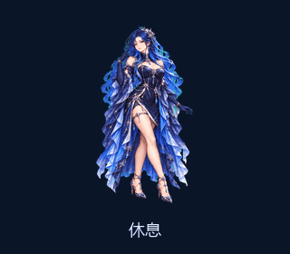
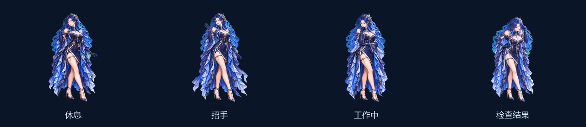

<div align="center">

# XINGLAN · 星澜

**A little company from the cosmos.**

A blue-haired desktop companion for moments of focus and quiet.<br>
9 animation states · 16 gaze directions · Portable Windows app · Offline

[**Download for Windows**](https://github.com/luoshaobo69-arch/xinglan-desktop/releases/latest) · [**Interactive demo**](https://luoshaobo69-arch.github.io/xinglan-desktop/) · [简体中文](README.md)



</div>

Xinglan is an independent desktop character. Keep her in a corner of your screen, click to say hello, double-click for a little jump, or choose a working, waiting or reviewing pose. Pause her whenever you want a quieter workspace.

No account, API key or always-connected chat service is required. Once downloaded, she runs locally.

## Meet her in a minute

| Experience | Start here |
| --- | --- |
| **Windows desktop app** | Download the Windows x64 ZIP from [Releases](https://github.com/luoshaobo69-arch/xinglan-desktop/releases/latest), extract the entire folder and open `Xinglan.exe`. Python is bundled. |
| **Try before downloading** | Open the [interactive demo](https://luoshaobo69-arch.github.io/xinglan-desktop/). Try the nine animations and move the pointer to explore her gaze. |
| **Offline browser demo** | Download the Offline Demo ZIP, extract it and open `index.html`. From the source archive, open `docs/index.html`. |
| **Run or modify the source** | With Python 3.11+, install `requirements.txt` and run `python desktop/main.py`. |

> Keep the Windows package's supporting files beside the executable; do not move `Xinglan.exe` out on its own. The browser demo works across platforms. Native macOS and Linux desktop builds are not currently claimed as tested.

## Small interactions, plenty of character

- **Nine animation states:** idle, move right, move left, wave, jump, failure reaction, wait, work and review.
- **Sixteen gaze directions:** let her look toward the nearby pointer.
- **A place on your desktop:** transparent background, dragging, scaling, optional always-on-top and pause.
- **Optional app-aware poses:** map the foreground process name to a scene. This mode is off by default.
- **Local by design:** no chat-content access, keystroke logging, built-in telemetry or model account.
- **Ready to remix:** the source, all 73 character frames and the interactive demo are included.



## Controls

| Gesture | Action |
| --- | --- |
| Click | Wave |
| Double-click | Jump |
| Drag | Move the character; play the corresponding walking direction |
| Move the pointer nearby | Gaze follows when enabled |
| Right-click | States, scale, always-on-top, pause, automatic mode and quit |

Optional automatic mode uses **foreground application scenes**: VS Code, PyCharm and GPT map to working; Codex maps to reviewing; DeepSeek maps to waiting. It reads the foreground process name only, not window titles, files or conversations. It cannot know whether a model is generating, waiting for approval or has completed a task. Process names may vary between installations; manual poses remain available.

Xinglan is not an official ChatGPT, Codex or DeepSeek plugin. It does not replace a built-in pet in those products. It is a separate local desktop program.

## Run from source

```powershell
python -m venv .venv
.venv\Scripts\python -m pip install -r requirements.txt
.venv\Scripts\python desktop\main.py
```

Python 3.11+ and Tkinter are required. The standard Windows Python distribution normally includes Tkinter; Pillow is installed from the requirements file. See [the usage guide](docs/USAGE.md) for details.

## Character and implementation

| Component | Specification |
| --- | --- |
| Animation | 9 states / 57 frames |
| Gaze | 16 directions, clockwise from up |
| Atlas | Transparent 1536 × 2288 PNG; 8 columns × 11 rows; 192 × 208 cells |
| Desktop app | Python, Tkinter and Pillow; runtime included in the Windows package |
| Demo | Plain HTML / CSS / JavaScript; no build step or CDN |

The character was directed by the project author, created with AI assistance, and prepared as frame animation assets. It is a pre-rendered sprite character, not a real-time 3D model or a built-in conversational AI. Enlarging the character does not add detail to the original frames.

## Make her your own

Ideas, compatibility reports and reproducible bugs are welcome in [Issues](https://github.com/luoshaobo69-arch/xinglan-desktop/issues). For display problems, include the operating system, display scaling and reproduction steps. Please leave out private chats, tokens and sensitive files.

If Xinglan makes your desktop a little more welcoming, consider starring the repository or sharing the download link with a friend.

## License and credit

Code is available under **MIT**. Character assets are available under **CC BY 4.0**: retain attribution and indicate changes when reusing or adapting the artwork. See the license files in the repository. Third-party dependencies retain their own licenses.

Suggested attribution: **Xinglan — luoshaobo69-arch / xinglan-desktop (AI-assisted artwork, CC BY 4.0)**.
