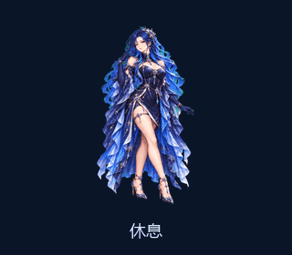
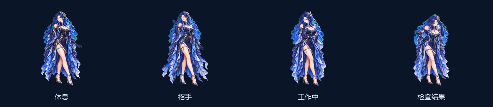

<div align="center">

# 星澜 · XINGLAN

**你的桌面，也有一片星海。**

一位蓝发星海伙伴，陪你专注，也陪你发呆。<br>
九种动作 · 十六向视线 · Windows 免安装 · 离线运行

[**下载 Windows 版**](https://github.com/luoshaobo69-arch/xinglan-desktop/releases/latest) · [**在线互动体验**](https://luoshaobo69-arch.github.io/xinglan-desktop/) · [English](README.en.md)



</div>

星澜是一款轻量的独立桌面角色。你可以把她拖到桌面一角，单击打招呼，双击让她轻轻跳起；忙起来时，让她工作、等待或检查，或者暂停动作，留一点安静给自己。

不用注册账号，不用配置 API Key，也没有需要保持连接的聊天服务。下载后，她就在本地。

## 先下载，再相遇

| 想怎样体验 | 从这里开始 |
| --- | --- |
| **Windows 桌面伙伴** | [Releases 下载 Windows x64 ZIP](https://github.com/luoshaobo69-arch/xinglan-desktop/releases/latest)，完整解压，双击 `Xinglan.exe`。无需安装 Python。 |
| **先在浏览器里试试** | 打开[互动演示](https://luoshaobo69-arch.github.io/xinglan-desktop/)，点击九种动作，移动鼠标体验视线跟随。 |
| **完全离线的浏览器演示** | 下载 Releases 中的 Offline Demo ZIP，完整解压并打开 `index.html`；也可以下载源码后打开 `docs/index.html`。 |
| **运行和修改源码** | Python 3.11+，安装 `requirements.txt`，运行 `python desktop/main.py`。 |

> Windows 版需要保留 ZIP 中的配套文件，不要单独移动 `Xinglan.exe`。macOS/Linux 用户可使用浏览器演示；当前没有承诺原生桌面版已在这些系统验证。

## 她能做什么

- **自然的小动作**：休息、招手、跳跃、左右移动，以及工作、等待、检查、遇到问题的反应。
- **视线跟随**：16 个方向的角色姿态，让她看向靠近的鼠标。
- **留在你喜欢的位置**：透明背景、拖动、缩放、可选置顶；需要安静时，一键暂停。
- **可选的应用场景模式**：右键开启后，根据前台应用的进程名切换角色姿态。默认关闭。
- **本地运行**：不读取聊天内容、不记录键盘输入、不内置遥测，不需要模型账户。
- **可以继续创作**：代码、73 帧透明角色图集和互动演示都在这个仓库。



## 互动速查

| 操作 | 反应 |
| --- | --- |
| 单击角色 | 招手 |
| 双击角色 | 跳跃 |
| 拖动角色 | 移动位置，朝移动方向迈步 |
| 鼠标靠近 | 启用视线跟随后，看向鼠标 |
| 右键 | 选择状态、大小、置顶、暂停、自动模式或退出 |

自动姿态使用的是**应用场景映射**：VS Code、PyCharm、GPT 对应工作姿态；Codex 对应检查；DeepSeek 对应等待。它只查看前台程序的进程名，不读取窗口标题、文件内容或对话，也不会判断模型是否正在生成答案。不同安装版本的进程名称可能不同，手动选择姿态始终可用。

星澜不是 ChatGPT、Codex 或 DeepSeek 的官方插件，也不会替换这些软件中的原生角色。她是一个独立的本地桌面程序。

## 从源码运行

```powershell
python -m venv .venv
.venv\Scripts\python -m pip install -r requirements.txt
.venv\Scripts\python desktop\main.py
```

需要 Python 3.11+ 和 Tkinter。Windows 官方 Python 安装包通常包含 Tkinter；Pillow 通过依赖文件安装。开发、构建及使用说明见 [docs/USAGE.md](docs/USAGE.md)。

## 角色与技术

| 内容 | 规格 |
| --- | --- |
| 动作 | 9 种，共 57 帧 |
| 视线 | 从上方开始，顺时针 16 个方向 |
| 图集 | 1536 × 2288 透明 PNG，8 列 × 11 行；每格 192 × 208 |
| 桌面 | Python、Tkinter、Pillow；Windows 发布包包含运行时 |
| 演示页 | 原生 HTML / CSS / JavaScript，无构建步骤、无 CDN |

角色由项目作者提出设计方向，使用 AI 辅助生成，再整理为逐帧动画素材。画面是预绘制的 sprite 动画；它不是实时 3D 模型，也不是内置聊天 AI。放大显示不会增加原始帧细节。

## 一起让她更好

欢迎通过 [Issues](https://github.com/luoshaobo69-arch/xinglan-desktop/issues) 提交想法、适配问题或可复现的错误，也欢迎贡献代码。反馈显示问题时，说明操作系统、屏幕缩放比例、复现步骤即可；请不要附带私人聊天、令牌或敏感文件。

如果星澜让你的桌面多了一点好心情，可以给项目一颗 Star，或把下载链接分享给同样喜欢桌面角色的朋友。

## 许可与署名

代码使用 **MIT** 许可；角色素材使用 **CC BY 4.0** 许可，使用或修改素材时请保留作者与项目署名并标明改动。详见仓库中的许可证文件。第三方软件依赖仍遵守各自的许可证。

推荐素材署名：**星澜 Xinglan — luoshaobo69-arch / xinglan-desktop（AI 辅助创作，CC BY 4.0）**。
